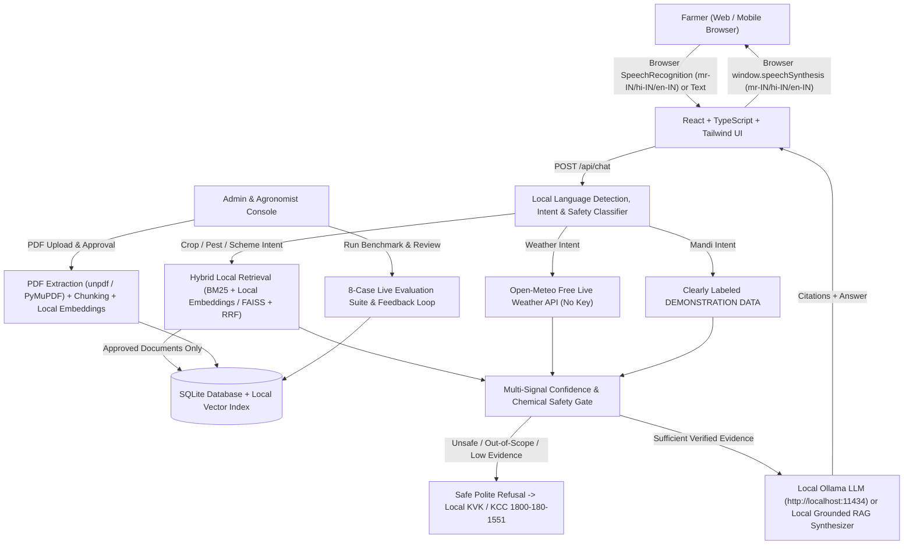

# KrishiMitra AI — Zero-Credential Local Architecture

## Architecture Layers (Zero API Keys Required)

1. **Browser Speech Input & Output (`src/components/AssistantView.tsx`)**: Uses native `window.SpeechRecognition` / `webkitSpeechRecognition` for Marathi, Hindi, and English voice input (with text fallback where unsupported) and native `window.speechSynthesis` for spoken replies.
2. **Local NLU & Query Understanding (`server/localAiClient.ts`)**: Detects Marathi, Hindi, and English, classifies intent, flags unsafe pesticide requests, and expands queries with the multilingual agricultural glossary.
3. **Knowledge Ingestion & Local Vector Index (`server/services/ragPipeline.ts`, `backend/main.py`)**: Extracts text per page using `unpdf` (or `PyMuPDF` in FastAPI), deduplicates via SHA-256 hash, chunks with page tracking, builds 384-d local multilingual vectors (or FAISS + `multilingual-e5-small` in Python), and persists to SQLite + `data/local_vectors.json`.
4. **Local LLM Generation (`Ollama` + Grounded Extractive Fallback)**: Routes to local Ollama (`OLLAMA_BASE_URL`, e.g. `qwen2.5:3b`) when running, and seamlessly falls back to a deterministic Local Grounded Extractive Synthesizer when Ollama is not started so the app never fails to boot or answer.
5. **External Tools**: Open-Meteo API for live weather without API keys, and clearly labeled **DEMONSTRATION DATA** for Mandi market rates.
